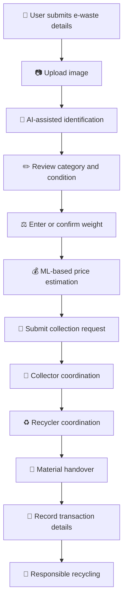
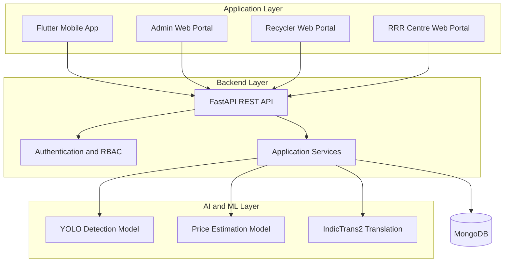

# ♻️ Kabadiwala Connect

### AI-Powered E-Waste Collection & Recycling Platform

**Connecting waste generators, informal collectors, and authorized recyclers through intelligent identification, transparent price estimation, and traceable recycling workflows.**

<p align="center">
  
  
  
  
  
</p>

---

## 🌍 Overview

Electronic waste contains valuable materials that can be recovered and reused. However, identifying recyclable components, estimating their value, finding reliable recycling partners, and maintaining transparent transaction records can be challenging for informal waste collectors.

**Kabadiwala Connect** is an AI-enabled platform designed to help bridge the gap between informal e-waste collection and the formal recycling ecosystem.

The platform combines computer vision, machine-learning-based price estimation, multilingual safety guidance, and digital record management to support a more accessible and organized recycling workflow.

By bringing users, collectors, recyclers, and recycling-centre operators into a connected digital ecosystem, the project aims to encourage responsible e-waste handling and improve transparency throughout the recycling process.

## 🎯 Problem Statement

The e-waste recycling ecosystem faces several challenges:

- Limited access to reliable information about recyclable materials.
- Difficulty estimating the value of collected e-waste.
- Fragmented communication between informal collectors and authorized recyclers.
- Safety concerns during the handling and storage of electronic waste.
- Language barriers that limit access to digital services.
- Limited digital traceability of collection, handover, and transaction activities.

Kabadiwala Connect explores how AI and connected applications can help address these challenges.

## 💡 Our Solution

The platform brings multiple capabilities into one connected system:

- **AI-assisted identification:** Analyze uploaded e-waste images using a YOLO-based model.
- **Intelligent price estimation:** Generate indicative prices using a machine-learning pricing model.
- **Collection coordination:** Support communication and coordination between users and collectors.
- **Recycler connectivity:** Facilitate the movement of recyclable materials toward recycling partners.
- **Safety guidance:** Provide material-specific handling recommendations.
- **Multilingual accessibility:** Translate supported English content into Indian languages.
- **Digital records:** Support organized records for submissions, status changes, and transaction workflows.
- **Role-based access:** Separate application capabilities for different user roles.

## ✨ Key Features

<table>
  <tr>
    <td width="50%" valign="top">
      <h3>🤖 AI-Based E-Waste Identification</h3>
      Upload an image and use the integrated YOLO model to assist with identifying e-waste categories. Users can review the result before proceeding.
    </td>
    <td width="50%" valign="top">
      <h3>💰 ML-Based Price Estimation</h3>
      Use available item details, such as category and weight, to generate an indicative scrap price for informed decision-making.
    </td>
  </tr>
  <tr>
    <td width="50%" valign="top">
      <h3>🦺 Material-Specific Safety Guidance</h3>
      Present relevant precautions for handling different types of electronic waste and encourage responsible practices.
    </td>
    <td width="50%" valign="top">
      <h3>🌐 Multilingual Support</h3>
      Use IndicTrans2-based English-to-Indian-language translation to make supported content more accessible.
    </td>
  </tr>
  <tr>
    <td width="50%" valign="top">
      <h3>🔔 In-App Notifications</h3>
      Maintain notifications for supported submission and collection status changes.
    </td>
    <td width="50%" valign="top">
      <h3>🔐 Role-Based Access</h3>
      Organize access to application features using authentication and role-based authorization.
    </td>
  </tr>
  <tr>
    <td width="50%" valign="top">
      <h3>♻️ Recycler Coordination</h3>
      Support a workflow for connecting collected materials with recycling partners.
    </td>
    <td width="50%" valign="top">
      <h3>🧾 Digital Traceability</h3>
      Build toward structured collection, handover, and transaction records to improve accountability.
    </td>
  </tr>
</table>

*Feature availability depends on the current implementation. Planned or partially implemented workflows are not necessarily production-ready.*

## 🔄 Application Workflow



This diagram represents the intended end-to-end workflow. Individual steps should be validated against the features currently implemented in the application.

## 🏗️ System Architecture



### Architecture Components

| Component | Responsibility |
|---|---|
| Flutter mobile app | Mobile user and collector workflows |
| React web portals | Administrative, recycler, and recycling-centre interfaces |
| FastAPI backend | API endpoints, application logic, and integration |
| MongoDB | Persistent application data |
| YOLO model | Image-based object detection and identification assistance |
| Pricing model | Indicative scrap value estimation |
| IndicTrans2 | English-to-Indian-language translation |
| JWT and RBAC | Authentication and role-based access control |

## 👥 User Roles

### 👤 User
- Submit e-waste information and images.
- Review identification results and estimated prices.
- Access supported safety guidance.
- Track supported notifications and submission updates.

### 🚚 Collector
- Participate in collection workflows.
- Coordinate material collection and movement.
- Support recording of collected material details.

### ♻️ Recycler
- Participate in recycler coordination workflows.
- Review relevant material information.
- Support recycling and handover activities.

### 🏭 RRR Centre
- Access relevant recycling-centre functionality.
- Support the formal recycling workflow.

### 🛡️ Administrator
- Manage authorized application access.
- Oversee supported administrative operations.
- Monitor relevant platform records.

The exact capabilities available to each role depend on the current implementation and authorization configuration.

## 🛠️ Technology Stack

<table>
  <tr>
    <th>Category</th>
    <th>Technologies</th>
  </tr>
  <tr>
    <td>Mobile Development</td>
    <td>Flutter, Dart</td>
  </tr>
  <tr>
    <td>Web Development</td>
    <td>React, TypeScript, Vite</td>
  </tr>
  <tr>
    <td>Backend</td>
    <td>Python, FastAPI</td>
  </tr>
  <tr>
    <td>Database</td>
    <td>MongoDB, MongoDB Atlas</td>
  </tr>
  <tr>
    <td>Computer Vision</td>
    <td>YOLO, Ultralytics</td>
  </tr>
  <tr>
    <td>Machine Learning</td>
    <td>Python, trained pricing model</td>
  </tr>
  <tr>
    <td>Language Translation</td>
    <td>AI4Bharat IndicTrans2</td>
  </tr>
  <tr>
    <td>Security</td>
    <td>JWT, role-based access control</td>
  </tr>
  <tr>
    <td>Testing</td>
    <td>Pytest, Flutter testing tools</td>
  </tr>
</table>

## 📂 Project Structure

```text
Kabadiwala-Connect/
│
├── backend/
│   ├── app/                 # Backend application modules
│   ├── ai/
│   │   ├── detection/       # Object detection model and integration
│   │   └── pricing/         # Price estimation model and integration
│   ├── tests/               # Backend tests, if present
│   └── ...
│
├── mobile/                  # Flutter mobile application
│
├── admin-web/               # Admin portal
├── recycler-web/            # Recycler portal
├── rrr-centre-web/          # Recycling-centre portal
│
├── docs/                    # Project documentation
├── .gitignore
├── README.md
└── ...
```

*This is a representative overview. Refer to the repository for the exact directory structure and file names.*

## 🚀 Getting Started

Follow these instructions to set up the development environment. Some commands and configuration values may need adjustment according to the current project files.

### Prerequisites

Install the following tools:

- [Git](https://git-scm.com/downloads)
- [Python](https://www.python.org/downloads/)
- [Flutter SDK](https://docs.flutter.dev/get-started/install)
- [Node.js and npm](https://nodejs.org/)
- [MongoDB](https://www.mongodb.com/) or a configured MongoDB Atlas database

### 1. Clone the Repository

```bash
git clone https://github.com/ahanya-n/Kabadiwala-Connect.git
cd Kabadiwala-Connect
```

### 2. Configure the Backend

Navigate to the backend:

```bash
cd backend
python -m venv .venv
```

Activate the virtual environment on Windows PowerShell:

```powershell
.venv\Scripts\Activate.ps1
```

Install dependencies if the repository contains `requirements.txt`:

```bash
pip install -r requirements.txt
```

Configure the required environment variables using the provided example configuration, if available. Set your database connection string, authentication secrets, and other required values locally.

Start the backend using the entry point and command documented in the backend configuration.

When enabled, FastAPI's interactive API documentation is commonly available at:

```text
http://127.0.0.1:8000/docs
```

### 3. Run the Mobile Application

Open a new terminal at the repository root:

```bash
cd mobile
flutter pub get
flutter run
```

Ensure an Android emulator or compatible device is available. Configure the API base URL appropriately for the selected device or emulator.

### 4. Run a Web Portal

For example, to start the admin portal:

```bash
cd admin-web
npm install
npm run dev
```

For other portals, use their respective directories:

- `recycler-web`
- `rrr-centre-web`

Check each portal's `package.json` for available scripts and configuration requirements.

### 5. Configure AI Models

Ensure that the required model files are present at the paths expected by the backend.

The repository includes model integration for:

- YOLO-based image identification.
- Machine-learning-based price estimation.
- IndicTrans2-based translation.

Some models may require additional Python dependencies, compatible hardware, or model downloads. Follow the relevant configuration and dependency instructions before running inference.

## 🔐 Security Best Practices

- Never commit `.env` files, passwords, private keys, or real API tokens.
- Keep secrets in local environment variables or an appropriate secret manager.
- Use `.env.example` to document configuration without exposing secret values.
- Enforce authorization checks on protected backend endpoints.
- Validate uploaded files and user-provided inputs.
- Avoid storing unnecessary personal or location information.
- Do not mark a payment as verified without suitable transaction evidence.
- Treat AI predictions and estimated prices as decision-support outputs, not guaranteed results.

## 🧪 Testing and Validation

Run the test suites provided by each component before using a new build.

### Backend

From the backend directory, activate the development environment and run:

```bash
pytest
```

### Mobile Application

From the mobile directory, run:

```bash
flutter test
```

### Web Portals

From the relevant portal directory, use the scripts defined in `package.json`. For example:

```bash
npm run build
```

### Recommended Release Checklist

- [ ] Backend starts with the configured environment.
- [ ] Database connectivity works.
- [ ] Authentication and role permissions are verified.
- [ ] YOLO model loads and produces expected output.
- [ ] Price estimation handles invalid inputs safely.
- [ ] Translation works for supported language pairs.
- [ ] Mobile application communicates with the backend.
- [ ] Web portals build successfully.
- [ ] Collection and handover workflows are tested end to end.
- [ ] No credentials or private user data are included in version control.

## 🖼️ Application Screenshots

Screenshots help visitors understand the application before installing it. Add genuine screenshots of your running project to `docs/images/`.

### Mobile Application


### AI-Based Identification


### Price Estimation


### Web Dashboard


**Important:** These image paths are placeholders. Add the corresponding image files before publishing this section, or remove any screenshot section whose image is not yet available.

## 🌱 Expected Impact

Kabadiwala Connect aims to contribute to a more organized and accessible e-waste recycling ecosystem.

- **Accessibility:** Help informal collectors access digital tools and material information.
- **Price transparency:** Provide indicative pricing information to support informed decisions.
- **Safety awareness:** Make material-specific handling guidance easier to access.
- **Coordination:** Improve digital coordination between collection and recycling participants.
- **Traceability:** Support structured records of collection and material movement.
- **Resource recovery:** Encourage responsible handling and formal recycling of electronic waste.

These are intended outcomes. Actual environmental and economic impact requires evaluation using real-world data and operational deployment.

## 🗺️ Roadmap

The following are potential enhancements and should not be interpreted as completed features unless verified in the codebase.

- [ ] Reliable offline data capture and synchronization.
- [ ] End-to-end collection tracking.
- [ ] Stronger handover and transaction verification.
- [ ] Expanded language and accessibility support.
- [ ] Integration with verified recycler information.
- [ ] Improved model evaluation using representative data.
- [ ] Production deployment, monitoring, and security hardening.
- [ ] Real-world usability and impact evaluation.

## 📚 References

- [Central Pollution Control Board (CPCB)](https://cpcb.nic.in/)
- [Ministry of Environment, Forest and Climate Change](https://moef.gov.in/)
- [E-Waste Management Rules, 2022 — official government resources](https://moef.gov.in/)
- [Ultralytics YOLO Documentation](https://docs.ultralytics.com/)
- [FastAPI Documentation](https://fastapi.tiangolo.com/)
- [Flutter Documentation](https://docs.flutter.dev/)
- [MongoDB Documentation](https://www.mongodb.com/docs/)
- [AI4Bharat](https://ai4bharat.iitm.ac.in/)

For regulatory or compliance decisions, consult the latest official rules, amendments, and authorization requirements.

## 🤝 Contributing

Contributions, suggestions, bug reports, and testing feedback are welcome.

1. Fork this repository.
2. Create a feature branch.
3. Implement and test your changes.
4. Commit your changes with a descriptive message.
5. Submit a pull request explaining the changes.

Please do not include credentials, private datasets, or sensitive personal information in contributions.

## 📄 License

A license has not been specified in this README. Add the license selected for this project and include its corresponding `LICENSE` file before granting permissions for reuse or redistribution.

---

<p align="center">
  <strong>♻️ Turning e-waste into opportunity through technology.</strong>
  <br />
  Building toward a cleaner, safer, and more transparent recycling ecosystem.
</p>
