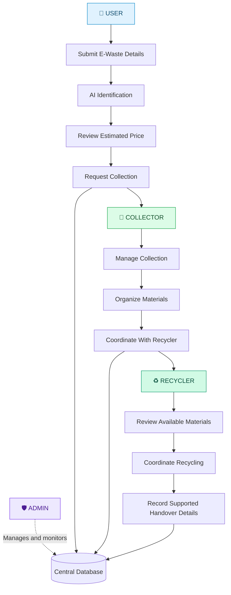
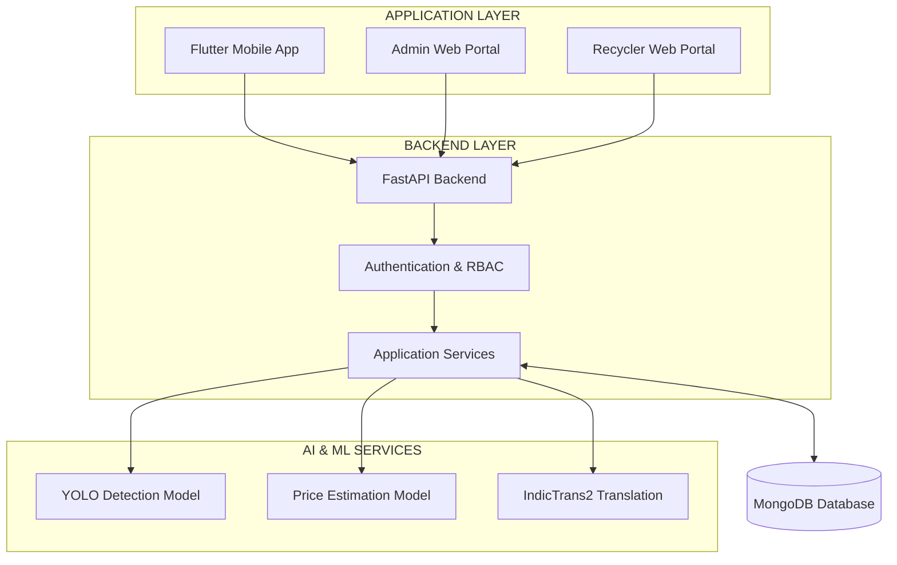

# ♻️ Kabadiwala Connect

### Smart E-Waste Collection, Valuation & Recycling Platform

<p align="center">
  
</p>

<p align="center">
  <strong>Identify smarter. Collect responsibly. Recycle sustainably.</strong>
</p>

<p align="center">
  An AI-powered platform connecting users, waste collectors, and recyclers through intelligent identification, price estimation, and centralized administration.
</p>

<p align="center">
  <a href="#features">Features</a> &nbsp;·&nbsp;
  <a href="#how-it-works">How It Works</a> &nbsp;·&nbsp;
  <a href="#technology-stack">Technology</a> &nbsp;·&nbsp;
  <a href="#getting-started">Get Started</a>
</p>

---

## 🌱 About the Project

Electronic waste contains valuable materials that can be recovered and reused. However, identifying recyclable components, estimating their value, finding suitable recycling partners, and maintaining transparent records can be challenging.

**Kabadiwala Connect** is an AI-powered e-waste management platform designed to connect users, informal waste collectors, and recyclers through a unified digital ecosystem.

The platform combines computer vision, machine-learning-based price estimation, multilingual safety guidance, and digital record management to help organize the e-waste collection and recycling journey.

A centralized **Admin Portal** supports the management and monitoring of platform information and operational activities.

## 🎯 The Vision

To make e-waste collection more accessible, transparent, and organized by connecting the people who generate electronic waste with the collectors and recyclers who help recover valuable materials.

### The challenges we aim to address

- Limited access to information about recyclable electronic materials.
- Difficulty estimating the value of discarded electronics.
- Fragmented coordination between collectors and recyclers.
- Safety concerns when handling electronic waste.
- Language barriers in accessing digital services.
- Limited visibility into collection and transaction records.

## ✨ Features

<table>
  <tr>
    <td width="50%" valign="top">
      <h3>🤖 AI-Powered Identification</h3>
      Analyze uploaded e-waste images using a YOLO-based detection model to assist with identifying electronic waste categories.
    </td>
    <td width="50%" valign="top">
      <h3>💰 Intelligent Price Estimation</h3>
      Use a machine-learning pricing model to generate an indicative scrap value from available material details, including category and weight.
    </td>
  </tr>
  <tr>
    <td width="50%" valign="top">
      <h3>📱 User Experience</h3>
      Submit e-waste details, review identification results, access safety guidance, and use supported collection workflows.
    </td>
    <td width="50%" valign="top">
      <h3>🚚 Collector Management</h3>
      Support collection activities and coordinate the movement of recyclable materials toward recycling partners.
    </td>
  </tr>
  <tr>
    <td width="50%" valign="top">
      <h3>♻️ Recycler Connectivity</h3>
      Connect collectors with recyclers through a structured workflow for reviewing materials and coordinating recycling activities.
    </td>
    <td width="50%" valign="top">
      <h3>🛡️ Centralized Administration</h3>
      Provide a dedicated admin portal for managing authorized access and overseeing supported platform operations.
    </td>
  </tr>
  <tr>
    <td width="50%" valign="top">
      <h3>🌐 Multilingual Accessibility</h3>
      Use supported English-to-Indian-language translation to make application content more accessible.
    </td>
    <td width="50%" valign="top">
      <h3>🔔 Notifications & Digital Records</h3>
      Maintain supported in-app notifications and structured records for submissions and status changes.
    </td>
  </tr>
</table>

*AI-generated classifications and price estimates are decision-support outputs, not guaranteed results. Feature availability depends on the current implementation.*

## 🔄 How It Works

The platform follows a connected recycling workflow: users submit e-waste, collectors coordinate collection, and recyclers support the downstream recycling process. The admin manages and monitors platform information across the ecosystem.



## 🏗️ System Architecture



### Architecture Components

| Component | Responsibility |
|---|---|
| Flutter Mobile App | Mobile user and collector workflows |
| Admin Web Portal | Centralized management and monitoring |
| Recycler Web Portal | Recycler-facing workflows |
| FastAPI | Backend APIs and application logic |
| MongoDB | Persistent application data |
| YOLO | Image-based object detection |
| Pricing Model | Indicative scrap valuation |
| IndicTrans2 | Supported English-to-Indian-language translation |
| JWT & RBAC | Authentication and role-based access control |

## 👥 Platform Roles

| Role | Responsibilities |
|---|---|
| **User** | Submit e-waste details, review identification and estimated prices, and request collection through supported workflows. |
| **Collector** | Manage collection activities, organize recyclable materials, and coordinate with recyclers. |
| **Recycler** | Review available materials and coordinate recycling and supported handover activities. |
| **Admin** | Manage authorized access, oversee platform information, and monitor supported operational records across the ecosystem. |

The user-to-collector-to-recycler sequence represents the physical recycling journey. The admin provides centralized oversight rather than being another step in that journey.

## 🛠️ Technology Stack

<p align="center">
  
</p>

| Layer | Technologies |
|---|---|
| Mobile Development | Flutter, Dart |
| Web Development | React, TypeScript, Vite |
| Backend | Python, FastAPI |
| Database | MongoDB |
| Computer Vision | YOLO, Ultralytics |
| Price Estimation | Python, trained machine-learning model |
| Translation | AI4Bharat IndicTrans2 |
| Authentication | JWT, role-based access control |
| Testing | Pytest, Flutter testing tools |

## 📂 Project Structure

```text
Kabadiwala-Connect/
│
├── backend/
│   ├── app/                  # Backend application modules
│   ├── ai/
│   │   ├── detection/        # Image detection integration and weights
│   │   └── pricing/          # Price estimation model and integration
│   └── ...                   # Other backend modules
│
├── mobile/                   # Flutter mobile application
├── admin-web/                # Admin portal
├── recycler-web/             # Recycler portal
├── docs/                     # Documentation and project resources
├── .gitignore
└── README.md
```

*This is a high-level overview. Refer to the actual repository for the complete directory structure.*

## 🚀 Getting Started

### Prerequisites

Install the tools required to run the application:

- [Git](https://git-scm.com/downloads)
- [Python](https://www.python.org/downloads/)
- [Flutter SDK](https://docs.flutter.dev/get-started/install)
- [Node.js and npm](https://nodejs.org/)
- [MongoDB](https://www.mongodb.com/) or a configured MongoDB Atlas database

### 1. Clone the repository

```bash
git clone https://github.com/ahanya-n/Kabadiwala-Connect.git
cd Kabadiwala-Connect
```

### 2. Configure the backend

```bash
cd backend
python -m venv .venv
```

Activate the environment on Windows PowerShell:

```powershell
.venv\Scripts\Activate.ps1
```

If the backend contains a `requirements.txt` file, install its dependencies:

```bash
pip install -r requirements.txt
```

Configure the required environment variables using the project's example configuration, if provided. Keep database credentials, authentication secrets, and other private values in your local environment.

Start the backend using the entry point and command specified in the project configuration.

When enabled, FastAPI's interactive API documentation is commonly available at:

`http://127.0.0.1:8000/docs`

### 3. Run the mobile application

Open a new terminal from the repository root:

```bash
cd mobile
flutter pub get
flutter run
```

Make sure an Android emulator or compatible device is running and that the mobile application uses the correct backend URL.

### 4. Run the admin portal

Open another terminal at the repository root:

```bash
cd admin-web
npm install
npm run dev
```

For the recycler portal, use its directory and check the scripts in its `package.json`:

```bash
cd recycler-web
npm install
npm run dev
```

Run each portal from its own terminal.

### 5. Configure the AI services

Verify that the required detection and pricing model files are present at the paths expected by the backend. Install any additional model dependencies and configure translation services according to the project instructions.

> **Note:** These are starting commands. Verify the actual entry points, dependency files, environment variables, and startup scripts in the repository before treating this as a complete installation guide.

## 🔐 Security & Reliability

- Keep API keys, passwords, database credentials, and JWT secrets out of source control.
- Use environment variables for private configuration.
- Enforce role-based permissions on protected backend endpoints.
- Validate uploaded files and user-provided inputs.
- Protect personal and location information.
- Treat AI classifications and estimated prices as decision-support outputs.
- Record payments as verified only when supported by actual transaction evidence.
- Test collection and handover workflows before production deployment.

## 🧪 Testing & Validation

Run the tests provided by each component before using a new build.

### Backend

From the backend directory, activate the environment and run:

```bash
pytest
```

### Mobile Application

From the mobile directory, run:

```bash
flutter test
```

### Web Portals

From the relevant portal directory, run the scripts defined in `package.json`. For example:

```bash
npm run build
```

### Recommended validation checklist

- [ ] Backend starts with the required configuration.
- [ ] Database connectivity works.
- [ ] Authentication and role permissions are verified.
- [ ] Detection and pricing models load correctly.
- [ ] Translation works for supported language pairs.
- [ ] Mobile application communicates with the backend.
- [ ] Web portals build successfully.
- [ ] Collection and handover workflows are tested end to end.
- [ ] No credentials or private user data are included in version control.

## 🖼️ Application Screenshots

Screenshots help visitors understand the project quickly. Add genuine screenshots of the running application under `docs/images/`.

### Mobile Application


### AI Identification & Price Estimation


### Collector Workflow


### Recycler Portal


### Admin Dashboard


*These image paths are placeholders. Add the actual image files before publishing this section, or remove references to screenshots that are not available.*

## 🌱 Project Goals

Kabadiwala Connect aims to contribute to a more accessible and organized e-waste recycling ecosystem.

- **Accessibility:** Help users and collectors access digital tools and material information.
- **Price transparency:** Provide indicative pricing information for informed decisions.
- **Safer handling:** Make material-specific safety guidance easier to access.
- **Better coordination:** Strengthen connections between collectors and recycling partners.
- **Traceability:** Support structured collection and transaction records.
- **Centralized oversight:** Give administrators visibility into supported platform operations.
- **Responsible recycling:** Encourage appropriate handling and recovery of electronic waste.

These are intended outcomes. Actual environmental, financial, and operational impact requires real-world evaluation.

## 🗺️ Future Enhancements

Potential areas for further development include:

- End-to-end collection status tracking.
- Stronger handover and transaction verification.
- Expanded multilingual support.
- Integration with verified recycler information.
- Improved AI evaluation using representative data.
- Production deployment, monitoring, and security hardening.
- Real-world usability and impact evaluation.

These items should be updated as the implementation progresses.

## 📚 References

- [Central Pollution Control Board](https://cpcb.nic.in/)
- [Ministry of Environment, Forest and Climate Change](https://moef.gov.in/)
- [Ultralytics YOLO Documentation](https://docs.ultralytics.com/)
- [FastAPI Documentation](https://fastapi.tiangolo.com/)
- [Flutter Documentation](https://docs.flutter.dev/)
- [MongoDB Documentation](https://www.mongodb.com/docs/)
- [AI4Bharat](https://ai4bharat.iitm.ac.in/)

Consult the latest official regulations and authorization requirements before making real-world compliance decisions.

## 🤝 Contributing

Suggestions, bug reports, testing feedback, and code contributions are welcome.

1. Fork the repository.
2. Create a feature branch.
3. Implement and test your changes.
4. Commit with a descriptive message.
5. Submit a pull request explaining your changes.

Please do not include credentials, private datasets, or sensitive personal information in contributions.

## 📄 License

Add the license selected for this project and include the corresponding `LICENSE` file before granting reuse or redistribution permissions.

---

<p align="center">
  <strong>♻️ Connecting people, collection, and recycling for a cleaner future.</strong>
</p>

<p align="center">
  <sub>Built to support smarter e-waste management through technology.</sub>
</p>
